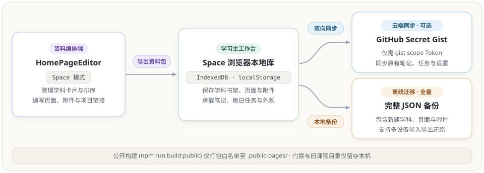

<div align="center">

# Kotori's Colorful Seika

<p><em>Learning is a colorful journey</em><br>林间书屋风格的个人学习空间、学科资料库与每日待办工作台</p>

<p>
  <a href="https://kotori-cjk.github.io/space/">在线访问</a> ·
  <a href="https://kotori-cjk.github.io/">返回 Kotori Homepage</a> ·
  <a href="https://kotori-cjk.github.io/recite/">课程背诵</a> ·
  <a href="https://github.com/Kotori-cjk/HomePageEditor">HomePageEditor</a>
</p>

<p></p>
<p><sub>樱影落窗，茶香伴卷——把日常课业、代码思维与手账笔记收进同一座静谧书房。</sub></p>

</div>

---

## 概览

`Colorful Seika` 是独立运行的个人学习工作区，与公开主页解耦。界面以林间书屋为意象，提供浅绿与天蓝双色切换、深浅色外观、门扉切换动画以及随文档高度自然延展的木纹桌面；数据采用**本地优先（Local-first）**架构，并支持通过 GitHub Secret Gist 与 JSON 资料包在多台设备间轻盈流转。

---

## 核心特性

- **林间书屋视觉与交互**：内建浅绿 / 天蓝强调色与深浅色主题，支持房间切换门扉动效、点击涟漪（遵循系统与站内动效开关）以及全屏观赏背景模式。
- **本地优先学科书架**：内置数理、计算机与 AI 学科分组；支持 Markdown 与 KaTeX 数学公式笔记、贴图、Obsidian / NotebookLM 快捷跳转，以及在本地浏览器 `IndexedDB` 中阅读由 [HomePageEditor](https://github.com/Kotori-cjk/HomePageEditor) 编排的多页学科读本与附件。
- **每日任务与提醒**：支持按日期或学科分类索引待办、月度完成热力图日历与本地到期通知（`task-notification-sw.js`）。
- **跨设备同步与备份**：既可连接仅含 `gist` 权限的 GitHub Secret Gist 自动同步原有学科笔记与任务，也可通过 JSON 一键导入导出包含学科目录、页面与附件的完整资料。

---

## 路由与公开边界

| 路由 | 页面 | 说明 |
| --- | --- | --- |
| `/space/` | Colorful Seika 主页 | 学科笔记、学科页面阅读器与每日任务工作台 |
| `/space/code-analysis/` | Code Analysis | 洛谷刷题、代码诊断与思维沉淀工作台 |
| `/recite/` | 课程背诵 | 独立公开课程背诵站 |

<picture>
  <source media="(prefers-color-scheme: dark)" srcset="docs/workflow-dark.svg">
  <source media="(prefers-color-scheme: light)" srcset="docs/workflow-light.svg">
  
</picture>

> 公开构建仅打包白名单内的静态文件至 `.public-pages/`；编辑器、个人资料预设及本机留存的旧交互目录（`algorithm/`、`cs-learning/`、`ai-recite/`、`seed.js`）均不进入 GitHub Pages 产物。

---

## 学科资料维护

通过同级的 [HomePageEditor](https://github.com/Kotori-cjk/HomePageEditor) 维护可携带的学科资料包：

1. 在 `HomePageEditor` 运行 `npm run editor`，打开 `http://localhost:8000/editor/` 并在顶部切换至 **Space** 模式，通过「管理学科」完成新增、排序、归档或恢复。
2. 选中学科后点击「新增页面」，可编写 Markdown、导入本地 `.md` / `.txt` 正文、添加资料链接与可下载附件。
3. 在学科编辑中指定「卡片跳转地址」，或点击「编辑项目链接」配置侧栏项目的名称、跳转目标与本机可见范围。
4. 点击「导出资料包」生成 JSON；在目标学习站打开 **设置 → 数据管理 → 导入学科资料包** 即可阅读。编辑器亦支持重新导入资料包继续维护；若需迁移全部笔记、任务与贴图，请使用「导出数据 / 导入数据」。

---

## 本机预览与公开构建

```powershell
npm ci
npm test
npm run preview
```

- **本机预览**：访问 `http://127.0.0.1:8000/`（需要与 `HomePageEditor` 同时运行时，可改用 `npm run preview -- --port=8001`）。本机环境保留了门禁登录与 `algorithm/`、`cs-learning/` 等旧交互目录，可直接将本机完整地址填入编辑器的「资料链接」。
- **公开产物验证**：
  ```powershell
  npm run build:public
  npm run preview -- --public
  ```
- **Gist 同步打包**：运行 `npm run build` 重新生成浏览器端 `sync/github-gist-sync.bundle.js`。

---

## Gist 同步与前端门禁

<details>
<summary><b>GitHub Secret Gist 跨设备同步说明</b></summary>

1. 创建一个 Classic personal access token，**仅勾选 `gist` scope**。
2. 在各台设备的 Space 设置中填入该 Token 并连接，页面会自动在对应账号下创建固定的 Secret Gist（Token 仅存该设备 `localStorage`，不写入仓库、Space 数据或 Gist 快照）。
3. 同步覆盖原有学科笔记、NotebookLM 链接、通用及原有学科任务、贴图、音乐与背景设置；新建学科、学科页面与附件通过本地 JSON 备份迁移。首次接入第二台设备或两端均有变更时，页面会提示明确选择拉取或上传方向。

</details>

<details>
<summary><b>本机静态前端门禁与密码修改</b></summary>

- 源码目录的私有 HTML 入口会校验登录状态，通过后在当前浏览器保持 7 天并自动返回原深层地址。
- 仓库只存储随机盐与 PBKDF2-SHA-256 派生哈希（`gate-config.js`），不保存明文密码；门禁状态同样不进入 Gist 同步快照。
- 本机修改访问密码：
  ```powershell
  powershell -ExecutionPolicy Bypass -File tools/set-password.ps1
  ```
- 注意：此机制属于静态前端门禁，资源文件本身仍可通过源码或绕过脚本直接访问。

</details>

---

## 致谢与关联

- 插画与房间素材授权见 [theme/room-assets/README.md](theme/room-assets/README.md)
- 配套站点与工具：[Kotori Homepage](https://github.com/Kotori-cjk/Kotori-cjk.github.io) · [HomePageEditor](https://github.com/Kotori-cjk/HomePageEditor)
