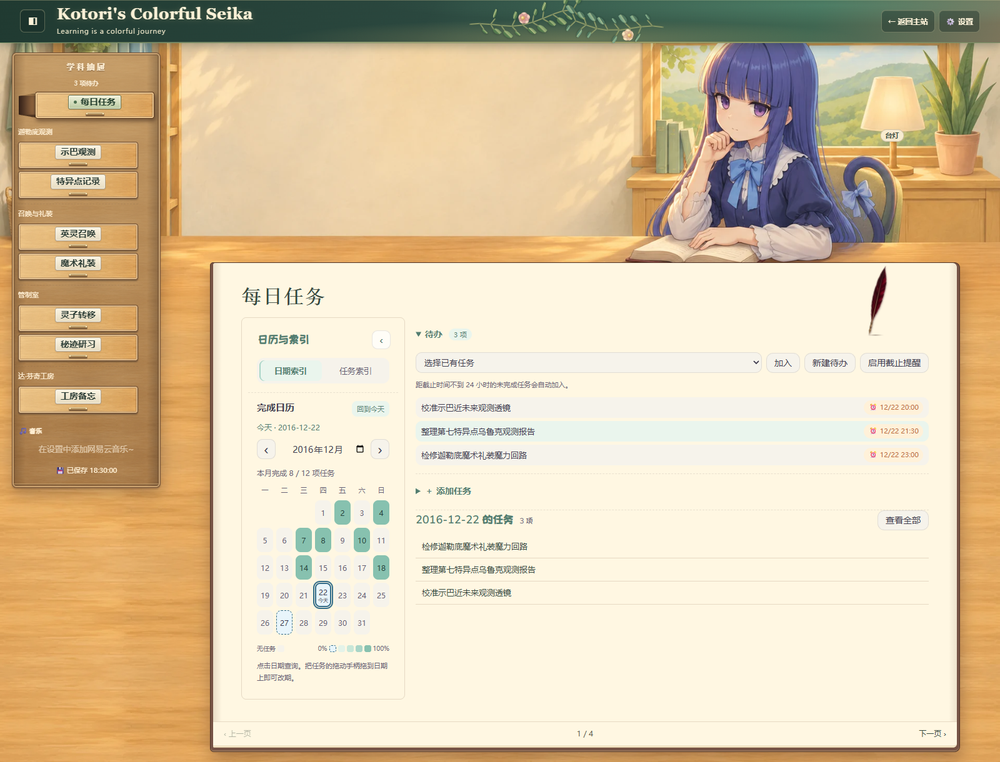
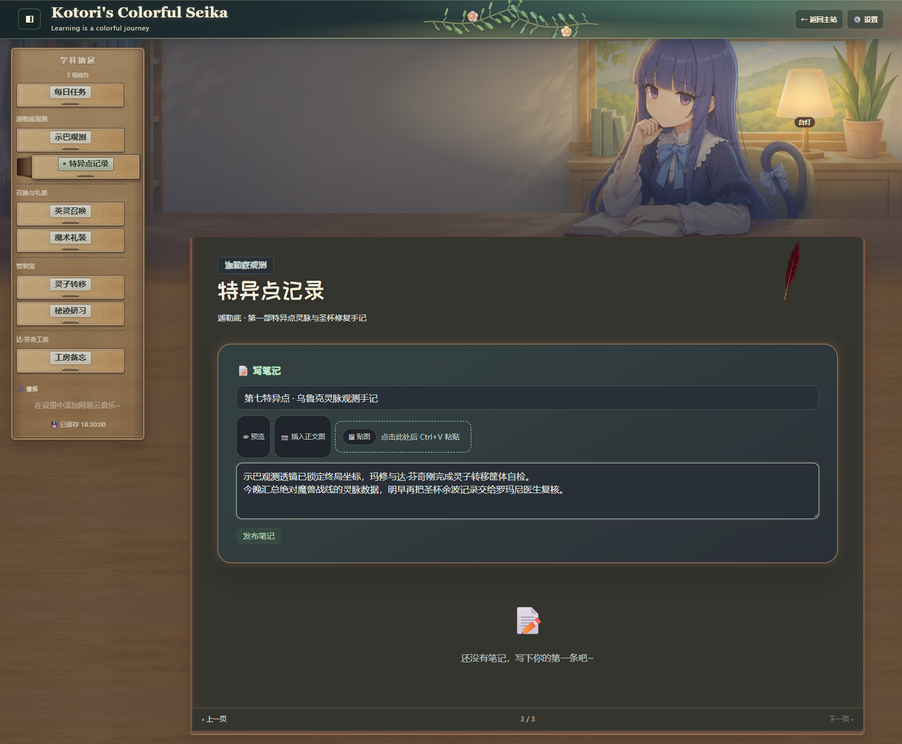
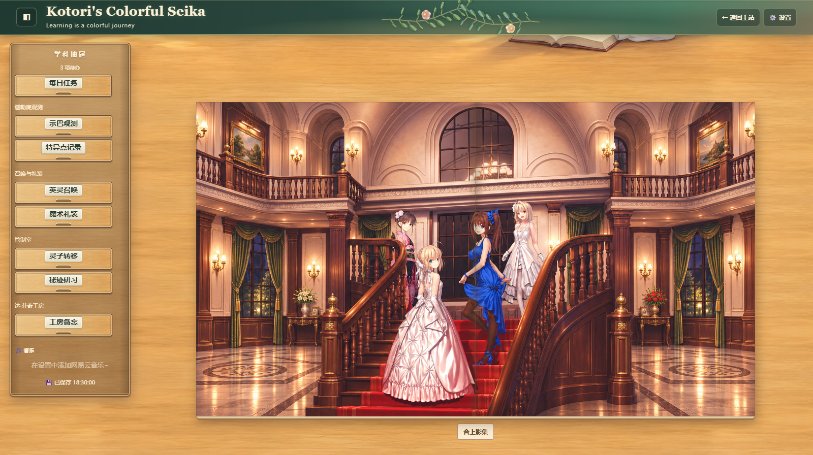

<div align="center">

# Kotori's Colorful Seika

<p><em>Learning is a colorful journey</em><br>林间书屋风格的互动书桌学习空间 · 学科资料库 · 每日待办手账</p>

<p>
  <a href="https://kotori-cjk.github.io/space/">在线访问</a> ·
  <a href="https://kotori-cjk.github.io/">返回 Kotori Homepage</a> ·
  <a href="https://kotori-cjk.github.io/recite/">课程背诵</a> ·
  <a href="https://github.com/Kotori-cjk/HomePageEditor">HomePageEditor</a>
</p>

<p></p>
<p><sub>樱影落窗，灯暖卷开——把日常课业、思维笔记与珍藏画册收进同一张随页面生长的林间木桌。</sub></p>

</div>

---

## 概览

`Colorful Seika` 是一座独立运行的个人学习书房，以「**林间互动书桌**」为核心意象重构阅读与记录体验：木纹抽屉收纳着各门学科，桌前羊皮手账由真实翻页引擎驱动，窗畔台灯掌管白昼与夜读切换，合上抽屉后还可在桌面摊开精装跨页影集。

数据采用**本地优先（Local-first）**架构——学科书架、多页读本与附件安放于本机浏览器的 `IndexedDB`，既可经 [HomePageEditor](https://github.com/Kotori-cjk/HomePageEditor) 编排迁移，也可通过 GitHub Secret Gist 与 JSON 备份在多设备间从容流转。

---

## 书房风物与交互美学 · 迦勒底见习簿

以型月（TYPE-MOON / Fate/Grand Order）世界观搭建的虚构书房演示（画面中的学科、人物、日程与插画均为本地演示素材）：

### 1. 白日书桌 · 木质抽屉、手账待办与分形花藤

拉开「每日任务」木抽屉，桌面随之摊开一份线装手账。同一视野内收拢了**月度完成热力日历**、**24 小时内临近截止提醒**与**任务索引**；点击右上角红色羽毛笔会轻盈摇晃，页面支持底部按钮、边缘滚轮、触控滑动与键盘方向键翻页。

顶栏木绿菜单条内嵌了由 **L-System 分形文法**（`lindenmayer.js`）生长的双色常春藤与五瓣花朵：鼠标滑过时顶栏金属光晕与藤蔓产生 3D 视差微倾，轻点粉花或白花还会使其绽放。桌面木纹亦会随文档内容向下自然铺展，长短页滚到底始终纹理不断。



### 2. 拨亮台灯 · 昼夜光影流转与纸页翻折

轻点窗前「台灯」开关，书房即刻从晨光切入暖灯夜读——室内光影收敛至灯罩晕影，手账纸面同步转为温和护眼的深色羊皮纸。点击左侧任意学科抽屉，抽屉会平滑探出并点亮绿底圆点标签，书页由 **OpenPageFlip** 渲染立体翻折动画，在多页学科读本与「写笔记」（Markdown、KaTeX 公式与剪贴板贴图）间自在翻阅。



### 3. 合上抽屉 · 桌面精装影集与跨页画册

将所有抽屉推进木柜，一张象牙白精装影集便显露于桌面。点击「翻开影集」，即可依据你上传并选中的背景插画原始比例，以双页跨页形式舒展装裱于书页之间，还原纸脊中缝折痕与立体纸边，点击「合上影集」再度归位。



<details>
<summary><b>交互与美学工艺细节一览</b></summary>

| 模块 | 实现位置 | 体验细节 |
| --- | --- | --- |
| **林间木纹与抽屉书架** | `theme/book-room/folio.js` · `folio.css` | 抽屉滑出位移动画、纸质标签点亮、`desk-wood.webp` 随页面高度纵向铺满 |
| **立体纸页翻折** | `theme/book-room/vendor/openpageflip.js` | 任务总览/详情与学科读本/笔记双面切叶，兼容滚轮边缘、触控与方向键 |
| **L-System 顶栏藤蔓** | `theme/book-room/vines.js` | 分形文法生成枝叶与可点击绽放的五瓣花朵，随指针移动产生光斑与 3D 视差 |
| **桌面台灯与羽毛笔** | `theme/book-room/folio.js` | 一键联动全站深浅色与室内灯晕；书页旁羽毛笔点击可触发轻晃动效 |
| **自适应跨页影集** | `theme/book-room/folio.css` · `folio.js` | 自动读取背景原图宽高比（`--album-ratio`）展开双页跨页与书脊阴影 |
| **无障碍与动效克制** | `theme/seika.js` · `folio.css` | 全面尊重系统 `prefers-reduced-motion` 与站内动效开关，关动效后直切无闪烁 |

</details>

---

## 核心特性与数据流转

- **本地优先学科书架**：内置数理、计算机与 AI 学科分组；笔记支持 Markdown、KaTeX 公式、剪贴板贴图与 Obsidian / NotebookLM 快捷跳转；新版学科页面与附件全部保存在浏览器 `IndexedDB`。
- **每日任务与提醒**：支持按日期或学科分类索引待办、月度完成度热力图与本地到期通知（`task-notification-sw.js`）。
- **跨设备同步与备份**：可选以仅含 `gist` 权限的 Classic PAT 连接 GitHub Secret Gist 自动同步原有学科笔记与任务；全部学科目录、页面、附件与笔记支持本地 JSON 一键导出与还原。

<picture>
  <source media="(prefers-color-scheme: dark)" srcset="docs/workflow-dark.svg">
  <source media="(prefers-color-scheme: light)" srcset="docs/workflow-light.svg">
  
</picture>

---

## 路由与公开边界

| 路由 | 页面 | 说明 |
| --- | --- | --- |
| `/space/` | Colorful Seika 主页 | 林间互动书桌、学科阅读器与每日任务手账 |
| `/space/code-analysis/` | Code Analysis | 洛谷刷题、代码诊断与思维沉淀工作台 |
| `/recite/` | 课程背诵 | 独立公开课程背诵站 |

> 公开构建（`npm run build:public`）仅将白名单静态资源打包至 `.public-pages/`；编辑器、个人资料预设及本机留存的旧交互目录（`algorithm/`、`cs-learning/`、`ai-recite/`、`seed.js`）均不进入 GitHub Pages 产物。

---

## 学科资料维护

通过同级的 [HomePageEditor](https://github.com/Kotori-cjk/HomePageEditor) 维护可携带的学科资料包：

1. 在 `HomePageEditor` 运行 `npm run editor`，打开 `http://localhost:8000/editor/` 并在顶部切换至 **Space** 模式，通过「管理学科」完成新增、排序、归档或恢复。
2. 选中学科后点击「新增页面」，可编写 Markdown、导入本地 `.md` / `.txt` 正文、添加资料链接与可下载附件。
3. 在学科编辑中指定「卡片跳转地址」，或点击「编辑项目链接」配置侧栏项目的名称、跳转目标与本机可见范围。
4. 点击「导出资料包」生成 JSON；在目标学习站打开 **设置 → 数据管理 → 导入学科资料包** 即可阅读。编辑器亦支持重新导入资料包继续维护；若需迁移全部笔记、任务与贴图，请使用「导出数据 / 导入数据」。

---

## 本机预览与公开构建

```powershell
npm ci
npm test
npm run preview
```

- **本机预览**：访问 `http://127.0.0.1:8000/`（需要与 `HomePageEditor` 同时运行时，可改用 `npm run preview -- --port=8001`）。本机环境保留了门禁登录与 `algorithm/`、`cs-learning/` 等旧交互目录，可直接将本机完整地址填入编辑器的「资料链接」。
- **公开产物验证**：
  ```powershell
  npm run build:public
  npm run preview -- --public
  ```
- **Gist 同步打包**：运行 `npm run build` 重新生成浏览器端 `sync/github-gist-sync.bundle.js`。

---

## Gist 同步与前端门禁

<details>
<summary><b>GitHub Secret Gist 跨设备同步说明</b></summary>

1. 创建一个 Classic personal access token，**仅勾选 `gist` scope**。
2. 在各台设备的 Space 设置中填入该 Token 并连接，页面会自动在对应账号下创建固定的 Secret Gist（Token 仅存该设备 `localStorage`，不写入仓库、Space 数据或 Gist 快照）。
3. 同步覆盖原有学科笔记、NotebookLM 链接、通用及原有学科任务、贴图、音乐与背景设置；新建学科、学科页面与附件通过本地 JSON 备份迁移。首次接入第二台设备或两端均有变更时，页面会提示明确选择拉取或上传方向。

</details>

<details>
<summary><b>本机静态前端门禁与密码修改</b></summary>

- 源码目录的私有 HTML 入口会校验登录状态，通过后在当前浏览器保持 7 天并自动返回原深层地址。
- 仓库只存储随机盐与 PBKDF2-SHA-256 派生哈希（`gate-config.js`），不保存明文密码；门禁状态同样不进入 Gist 同步快照。
- 本机修改访问密码：
  ```powershell
  powershell -ExecutionPolicy Bypass -File tools/set-password.ps1
  ```
- 注意：此机制属于静态前端门禁，资源文件本身仍可通过源码或绕过脚本直接访问。

</details>

---

## 致谢与关联

- 插画与房间素材授权见 [theme/room-assets/README.md](theme/room-assets/README.md)
- 互动书桌开源依赖（MIT）：[OpenPageFlip](theme/book-room/vendor/openpageflip.LICENSE.txt) · [Lindenmayer](theme/book-room/vendor/lindenmayer.LICENSE.txt)
- 配套站点与工具：[Kotori Homepage](https://github.com/Kotori-cjk/Kotori-cjk.github.io) · [HomePageEditor](https://github.com/Kotori-cjk/HomePageEditor)
